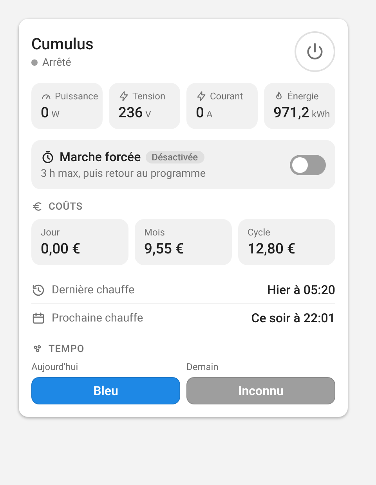
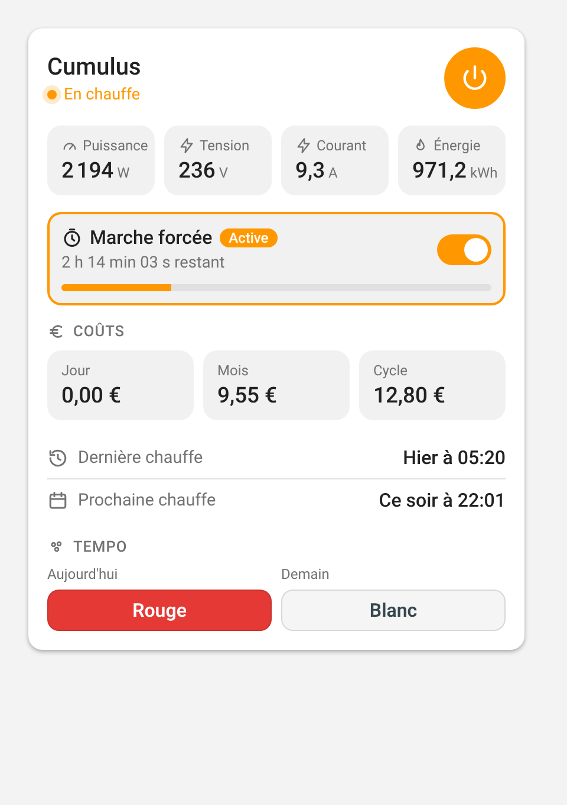
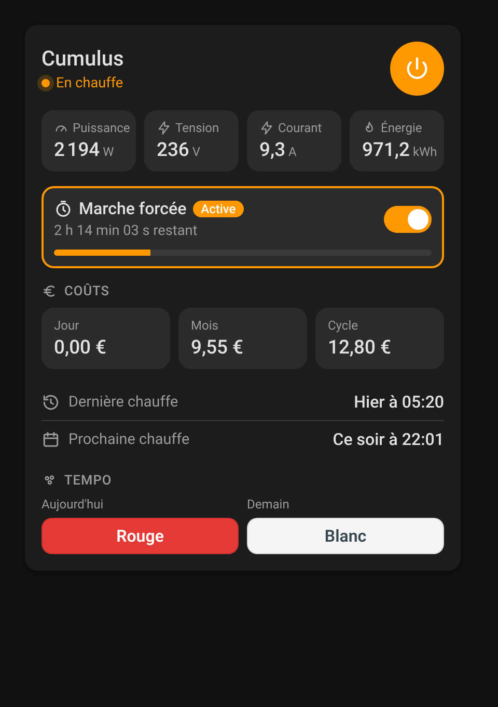

# Cumulus Card

[](https://github.com/TheDecryptZ/ha-cumulus-card/actions/workflows/validate.yml)
[](https://hacs.xyz)
[](LICENSE)

Carte Lovelace pour **piloter et suivre un cumulus (chauffe-eau)** dans Home Assistant, pensée pour une chauffe programmée une nuit sur deux en heures creuses avec les couleurs **Tempo** EDF.

| Cumulus arrêté | Chauffe + marche forcée | Thème sombre |
| :---: | :---: | :---: |
|  |  |  |

## Fonctionnalités

- **État et bouton on/off** du cumulus (un clic sur le titre ouvre la fiche de l'entité).
- **Mesures** : puissance, tension, courant et énergie cumulée.
- **Marche forcée** : interrupteur, durée restante en direct et barre de progression (3 h par défaut).
- **Coûts** : jour, mois et cycle.
- **Dernière chauffe** (relative : « Hier à 05:20 ») et **prochaine chauffe programmée**, calculée comme l'automatisation (une nuit sur deux, 22:01 → 06:00).
- **Couleurs Tempo** d'aujourd'hui et de demain (bleu, blanc, rouge, inconnu).
- **Éditeur visuel** complet : chaque entité, la plage horaire et les sections affichées sont configurables.
- Interface en français et en anglais (selon la langue de Home Assistant), thèmes clair et sombre.

## Installation

### Via HACS (recommandé)

1. Dans HACS, ouvrir le menu **⋮ → Dépôts personnalisés**.
2. Ajouter l'URL de ce dépôt, catégorie **Tableau de bord** (anciennement « Lovelace »).
3. Rechercher **Cumulus Card**, **Télécharger**, puis recharger le navigateur (Ctrl + F5).

La ressource `/hacsfiles/ha-cumulus-card/ha-cumulus-card.js` est ajoutée automatiquement.

### Manuelle

1. Copier `ha-cumulus-card.js` dans `/config/www/`.
2. Ajouter la ressource (**Paramètres → Tableaux de bord → ⋮ → Ressources**) :
   - URL : `/local/ha-cumulus-card.js`
   - Type : **Module JavaScript**

## Utilisation

Ajouter une carte **Cumulus Card** depuis l'éditeur visuel, ou coller le YAML ci-dessous.

### Exemple minimal

Les valeurs par défaut correspondent aux entités de l'exemple complet : si les vôtres portent ces noms, il suffit de :

```yaml
type: custom:cumulus-card
```

### Exemple complet

```yaml
type: custom:cumulus-card
name: Cumulus

# Cumulus et mesures
switch: switch.cumulus
power: sensor.cumulus_power
voltage: sensor.cumulus_voltage
current: sensor.cumulus_current
energy: sensor.cumulus_energy

# Marche forcée
force_boolean: input_boolean.marche_forcee_cumulus
force_timer: timer.cumulus_marche_forcee
force_duration: 3            # heures, utilisé si le minuteur n'expose pas sa durée

# Coûts
cost_day: sensor.cout_cumulus_jour
cost_month: sensor.cout_cumulus_mois
cost_cycle: sensor.cout_cumulus_cycle

# Programmation et Tempo
last_heat: input_datetime.cumulus_derniere_chauffe
automation: automation.gestion_cumulus_tempo_rte_dev
schedule_start: "22:01"
schedule_end: "06:00"
schedule_parity: 0           # 0 ou 1 : décale la chauffe d'une nuit
tempo_today: sensor.myelectricaldata_tempo_today
tempo_tomorrow: sensor.myelectricaldata_tempo_tomorrow

# Sections affichées
show_metrics: true
show_force: true
show_costs: true
show_schedule: true
show_tempo: true
```

### Options

| Option | Défaut | Description |
| --- | --- | --- |
| `name` | `Cumulus` | Titre de la carte. |
| `switch` | `switch.cumulus` | Interrupteur du cumulus (bouton on/off et état). |
| `power`, `voltage`, `current`, `energy` | voir ci-dessus | Capteurs de mesure ; laisser vide pour masquer une tuile. |
| `force_boolean` | `input_boolean.marche_forcee_cumulus` | Booléen de marche forcée (interrupteur de la carte). |
| `force_timer` | `timer.cumulus_marche_forcee` | Minuteur donnant le temps restant. |
| `force_duration` | `3` | Durée en heures si le minuteur n'expose pas `duration`. |
| `cost_day`, `cost_month`, `cost_cycle` | voir ci-dessus | Capteurs de coût ; laisser vide pour masquer une tuile. |
| `last_heat` | `input_datetime.cumulus_derniere_chauffe` | Date et heure de la dernière chauffe. |
| `automation` | `automation.gestion_cumulus_tempo_rte_dev` | Automatisation de gestion (affiche « désactivée » si elle est coupée). |
| `schedule_start` / `schedule_end` | `22:01` / `06:00` | Plage horaire de chauffe. |
| `schedule_parity` | `0` | Parité des nuits de chauffe (voir ci-dessous). |
| `tempo_today`, `tempo_tomorrow` | `sensor.myelectricaldata_tempo_*` | Capteurs de couleur Tempo (`BLUE`/`WHITE`/`RED` ou `bleu`/`blanc`/`rouge`). |
| `show_metrics`, `show_force`, `show_costs`, `show_schedule`, `show_tempo` | `true` | Affiche ou masque une section. |

## Fonctionnement

- **Interrupteur de marche forcée** : la carte ne fait que basculer le booléen. Le démarrage et l'annulation du minuteur restent confiés à votre automatisation (ici « fin de la marche forcée après 3 h »), pour ne pas dupliquer la logique.
- **Prochaine chauffe** : calculée côté navigateur avec la même règle que l'automatisation. Une nuit est active lorsque le numéro ordinal du jour où elle commence est pair (`date.toordinal() % 2 == 0` en Python). Si la prochaine chauffe affichée ne correspond pas à la vôtre, mettez `schedule_parity: 1`.
- **Compte à rebours** : calculé à partir de l'attribut `finishes_at` du minuteur, sans appels supplémentaires à Home Assistant.

## Développement

```bash
node --check ha-cumulus-card.js      # contrôle de syntaxe
pip install playwright && playwright install chromium
python3 test/run.py                  # tests de rendu, d'actions, de logique et d'éditeur
```

Le test génère aussi les captures d'écran du dossier `docs/`. La validation HACS est exécutée par GitHub Actions (`.github/workflows/validate.yml`).

## Licence

[MIT](LICENSE)
